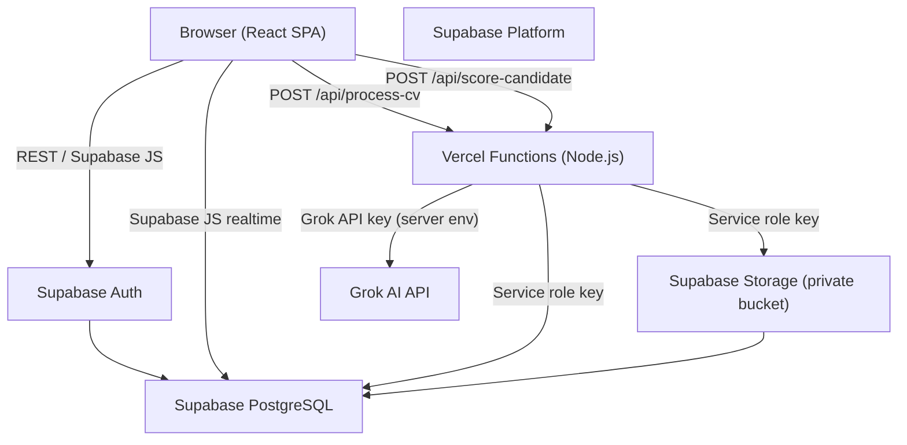
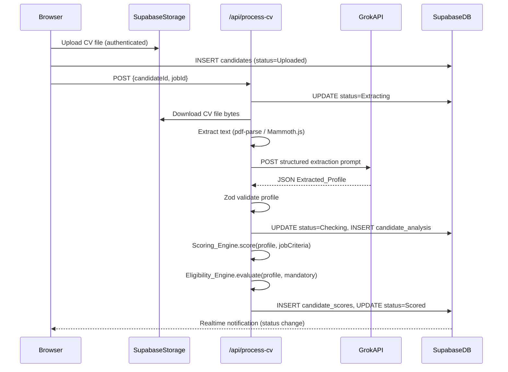

# Design Document: Intelligent CV Screening and Candidate Shortlisting System

## Overview

The system is a recruiter-facing web application that automates CV ingestion, AI-powered profile extraction, rule-based scoring, and candidate ranking. Recruiters sign in via Supabase Auth, create jobs with structured criteria and weighted scoring categories, upload CVs in bulk, and view a ranked shortlist with evidence-backed score breakdowns.

The architecture separates concerns into three layers:
- **Client**: React + TypeScript + Vite + Tailwind CSS single-page application
- **API**: Vercel Serverless Functions (Node.js + TypeScript) handling all sensitive operations
- **Platform**: Supabase providing PostgreSQL, Row Level Security, Auth, and private file Storage

CV processing flows through a linear pipeline: Upload → Text Extraction → AI Extraction → Zod Validation → Scoring → Eligibility Gating → Rank Assignment. The Scoring_Engine and Eligibility_Engine are pure TypeScript modules with no I/O dependencies, making them independently testable.

---

## Architecture



### Request Flow: CV Processing



---

## Components and Interfaces

### Frontend Pages

| Page | Route | Responsibility |
|---|---|---|
| LoginPage | `/login` | Supabase Auth sign-in form |
| SignUpPage | `/signup` | New recruiter registration |
| DashboardPage | `/dashboard` | Job list with status badges |
| JobSetupPage | `/jobs/new`, `/jobs/:id/edit` | Job creation/edit form |
| UploadPage | `/jobs/:id/upload` | CV file upload with per-file status |
| ResultsPage | `/jobs/:id/results` | Ranked shortlist + flagged section |
| CandidateDetailPage | `/jobs/:id/candidates/:cid` | Full profile + score breakdown |

### Frontend Components

```
src/components/
  auth/
    LoginForm.tsx           # Email/password form with error display
  dashboard/
    JobCard.tsx             # Job summary card with status badge
    JobList.tsx             # Paginated job list
  job-setup/
    SkillTagInput.tsx       # Multi-tag input for skills
    WeightInputGroup.tsx    # Four weight inputs with live sum display
    MandatoryRequirements.tsx # Free-text tag input for mandatory reqs
  upload/
    DropZone.tsx            # Drag-and-drop file area
    FileStatusRow.tsx       # Per-file status, progress, retry button
  results/
    CandidateTable.tsx      # Ranked eligible candidates table
    ScoreBreakdown.tsx      # Expandable score explanation panel
    FlaggedSection.tsx      # Not_Eligible / Needs_Review listing
  candidate-detail/
    ProfileSection.tsx      # Extracted profile display
    ScoreDetail.tsx         # Component score with rules + evidence
    StatusOverrideForm.tsx  # Override eligibility with reason
  common/
    StatusBadge.tsx         # Reusable badge for Processing/Eligibility status
    ErrorBanner.tsx         # Top-of-page error display
```

### API Layer (Vercel Functions)

#### `POST /api/process-cv`

Triggers the full pipeline for a single candidate.

```typescript
// Request
interface ProcessCvRequest {
  candidateId: string;   // UUID from candidates table
  jobId: string;         // UUID from jobs table
}

// Response 200
interface ProcessCvResponse {
  candidateId: string;
  processingStatus: ProcessingStatus;
  eligibilityStatus: EligibilityStatus;
  finalScore: number;
}

// Response 4xx/5xx
interface ApiError {
  error: string;
  stage?: 'extraction' | 'validation' | 'scoring' | 'eligibility';
}
```

#### `POST /api/score-candidate`

Re-scores an already-extracted candidate (e.g., after job criteria change).

```typescript
interface ScoreCandidateRequest {
  candidateId: string;
  jobId: string;
}
```

#### Authentication middleware

All Vercel Functions validate the `Authorization: Bearer <supabase_jwt>` header using Supabase's `auth.getUser()`. Requests without a valid session return HTTP 401.

### Backend Modules

#### `src/lib/supabase.ts`

Exports a typed Supabase client for browser use (anon key) and a separate server-side client factory using the service role key (imported only in `api/`).

#### `src/lib/grokClient.ts`

Server-only module. Wraps the Grok HTTP API with:
- Configurable system prompt for structured CV extraction
- 30-second request timeout
- Single retry on timeout or 5xx error
- Response typed as `unknown` then passed to Zod for validation

#### `src/lib/schemas.ts`

All Zod schemas exported from one file:

```typescript
export const ExperienceEntrySchema = z.object({
  employer: z.string(),
  title: z.string(),
  years: z.coerce.number().min(0),
  description: z.string(),
});

export const EducationEntrySchema = z.object({
  institution: z.string(),
  degree: z.string(),
  field: z.string(),
});

export const ProjectEntrySchema = z.object({
  name: z.string(),
  technologies: z.array(z.string()),
  description: z.string(),
});

export const ExtractedProfileSchema = z.object({
  name: z.string(),
  skills: z.array(z.string()),
  experience: z.array(ExperienceEntrySchema),
  education: z.array(EducationEntrySchema),
  projects: z.array(ProjectEntrySchema),
});

export type ExtractedProfile = z.infer<typeof ExtractedProfileSchema>;
```

#### `src/engine/scoring.ts`

Pure TypeScript. No imports outside of `../types`.

```typescript
export interface JobCriteria {
  requiredSkills: string[];
  preferredSkills: string[];
  minExperienceYears: number;
  educationRequirement: EducationLevel;
  weights: ScoreWeights;           // Skills, Experience, Projects, Education — sum = 100
}

export interface ScoreWeights {
  skills: number;
  experience: number;
  projects: number;
  education: number;
}

export interface ComponentScores {
  skills: number;
  experience: number;
  projects: number;
  education: number;
}

export interface ScoringResult {
  componentScores: ComponentScores;
  finalScore: number;
  preferredMatches: string[];
  explanation: ScoreExplanation;
}

export function scoreCandidate(
  profile: ExtractedProfile,
  criteria: JobCriteria,
): ScoringResult;

export function computeSkillsScore(
  candidateSkills: string[],
  requiredSkills: string[],
): number;

export function computeExperienceScore(
  totalYears: number,
  requiredYears: number,
): number;

export function computeEducationScore(
  candidateDegree: EducationLevel,
  requiredDegree: EducationLevel,
): number;

export function computeProjectsScore(
  projects: ProjectEntry[],
  requiredSkills: string[],
): number;

export function computeFinalScore(
  scores: ComponentScores,
  weights: ScoreWeights,
): number;
```

#### `src/engine/eligibility.ts`

Pure TypeScript.

```typescript
export type EligibilityStatus = 'Eligible' | 'Not_Eligible' | 'Needs_Review';

export interface EligibilityResult {
  status: EligibilityStatus;
  failedRequirements: string[];
  unclearRequirements: string[];
}

export function evaluateEligibility(
  profile: ExtractedProfile,
  mandatoryRequirements: string[],
): EligibilityResult;
```

#### `src/engine/ranking.ts`

Pure TypeScript.

```typescript
export interface RankedCandidate {
  candidateId: string;
  finalScore: number;
  componentScores: ComponentScores;
  preferredMatches: number;
  rank: number;
}

export function rankCandidates(candidates: RankedCandidate[]): RankedCandidate[];
```

---

## Data Models

### Database Schema (Supabase PostgreSQL)

```sql
-- Jobs table
CREATE TABLE jobs (
  id              UUID PRIMARY KEY DEFAULT gen_random_uuid(),
  owner_id        UUID NOT NULL REFERENCES auth.users(id) ON DELETE CASCADE,
  title           TEXT NOT NULL,
  description     TEXT,
  criteria        JSONB NOT NULL,    -- JobCriteria JSON
  weights         JSONB NOT NULL,    -- ScoreWeights JSON
  mandatory_requirements  TEXT[] DEFAULT '{}',
  created_at      TIMESTAMPTZ DEFAULT now(),
  updated_at      TIMESTAMPTZ DEFAULT now()
);

-- Candidates table
CREATE TABLE candidates (
  id                  UUID PRIMARY KEY DEFAULT gen_random_uuid(),
  job_id              UUID NOT NULL REFERENCES jobs(id) ON DELETE CASCADE,
  filename            TEXT NOT NULL,
  storage_path        TEXT NOT NULL,
  processing_status   TEXT NOT NULL DEFAULT 'Uploaded',
  eligibility_status  TEXT,
  override_status     TEXT,
  override_reason     TEXT,
  created_at          TIMESTAMPTZ DEFAULT now()
);

-- Candidate analysis (extracted profile)
CREATE TABLE candidate_analysis (
  id               UUID PRIMARY KEY DEFAULT gen_random_uuid(),
  candidate_id     UUID NOT NULL REFERENCES candidates(id) ON DELETE CASCADE,
  schema_version   INTEGER NOT NULL,
  extracted_profile JSONB NOT NULL,
  evidence_snippets JSONB,
  warnings         JSONB,
  analyzed_at      TIMESTAMPTZ DEFAULT now()
);

-- Candidate scores
CREATE TABLE candidate_scores (
  id               UUID PRIMARY KEY DEFAULT gen_random_uuid(),
  candidate_id     UUID NOT NULL REFERENCES candidates(id) ON DELETE CASCADE,
  rule_version     INTEGER NOT NULL,
  component_scores JSONB NOT NULL,
  preferred_matches JSONB,
  final_score      NUMERIC(5,2) NOT NULL,
  rank             INTEGER,
  explanation      JSONB,
  scored_at        TIMESTAMPTZ DEFAULT now()
);
```

### Row Level Security Policies

```sql
-- Jobs: owner can read/write their own jobs
ALTER TABLE jobs ENABLE ROW LEVEL SECURITY;
CREATE POLICY "jobs_owner" ON jobs
  USING (owner_id = auth.uid())
  WITH CHECK (owner_id = auth.uid());

-- Candidates: recruiter owns via job
ALTER TABLE candidates ENABLE ROW LEVEL SECURITY;
CREATE POLICY "candidates_owner" ON candidates
  USING (job_id IN (SELECT id FROM jobs WHERE owner_id = auth.uid()));

-- candidate_analysis: recruiter owns via candidate → job
ALTER TABLE candidate_analysis ENABLE ROW LEVEL SECURITY;
CREATE POLICY "analysis_owner" ON candidate_analysis
  USING (candidate_id IN (
    SELECT c.id FROM candidates c
    JOIN jobs j ON j.id = c.job_id
    WHERE j.owner_id = auth.uid()
  ));

-- candidate_scores: recruiter owns via candidate → job
ALTER TABLE candidate_scores ENABLE ROW LEVEL SECURITY;
CREATE POLICY "scores_owner" ON candidate_scores
  USING (candidate_id IN (
    SELECT c.id FROM candidates c
    JOIN jobs j ON j.id = c.job_id
    WHERE j.owner_id = auth.uid()
  ));
```

### TypeScript Types (`src/types/index.ts`)

```typescript
export type ProcessingStatus =
  | 'Uploaded'
  | 'Extracting'
  | 'Checking'
  | 'Scored'
  | 'Failed'
  | 'Needs_Review';

export type EligibilityStatus = 'Eligible' | 'Not_Eligible' | 'Needs_Review';

export type EducationLevel =
  | 'None'
  | 'High School'
  | "Bachelor's"
  | "Master's"
  | 'PhD';

export const EDUCATION_LEVELS: EducationLevel[] = [
  'None', 'High School', "Bachelor's", "Master's", 'PhD',
];

export const EDUCATION_TIER_SCORES: Record<EducationLevel, number> = {
  None: 0,
  'High School': 0,
  "Bachelor's": 50,
  "Master's": 70,
  PhD: 100,
};

export interface ScoreWeights {
  skills: number;
  experience: number;
  projects: number;
  education: number;
}
```

### Grok Extraction Prompt Template

The server-side prompt sent to the Grok API is a structured system + user message:

```
System: You are a CV parser. Extract information into JSON matching exactly this schema:
{
  "name": string,
  "skills": string[],
  "experience": [{ "employer": string, "title": string, "years": number, "description": string }],
  "education": [{ "institution": string, "degree": string, "field": string }],
  "projects": [{ "name": string, "technologies": string[], "description": string }]
}
Return ONLY the JSON object. Do not add commentary.

User: <CV_TEXT>
```

---

## Correctness Properties

*A property is a characteristic or behavior that should hold true across all valid executions of a system — essentially, a formal statement about what the system should do. Properties serve as the bridge between human-readable specifications and machine-verifiable correctness guarantees.*

The Scoring_Engine, Eligibility_Engine, Ranking_Engine, and Validator are pure TypeScript modules suitable for property-based testing. Infrastructure, UI rendering, and Supabase interactions use example-based and integration tests.

Property-based testing library: **fast-check** (TypeScript-first, actively maintained, excellent arbitrary generators).

---

### Property 1: Score_Weights live sum accuracy

*For any* four numeric inputs representing skill, experience, project, and education weights, the displayed sum computed by the WeightInputGroup component equals their arithmetic sum, and the error state is true if and only if the sum does not equal 100.

**Validates: Requirements 2.8, 2.9**

---

### Property 2: Skills_Score formula correctness

*For any* non-empty list of required skills and any candidate skill list, the Skills_Score computed by `computeSkillsScore` equals `(|intersection| / |requiredSkills|) × 100`, rounded to two decimal places, and is bounded to [0, 100].

**Validates: Requirements 5.1**

---

### Property 3: Experience_Score formula correctness

*For any* non-negative actual years and any required years, the Experience_Score computed by `computeExperienceScore` equals `min(actual / required, 1) × 100` rounded to two decimal places; when required years is 0 the score is 100; the score is always bounded to [0, 100].

**Validates: Requirements 5.2**

---

### Property 4: Education_Score tier ordering

*For any* candidate degree and required degree from the EducationLevel enum, the Education_Score computed by `computeEducationScore` equals the tier value of the candidate's degree; when the candidate's degree is at or above the required degree the score is never less than the score produced for the required degree itself.

**Validates: Requirements 5.3**

---

### Property 5: Projects_Score weighted average

*For any* non-empty list of project entries each carrying tech_relevance, requirement_relevance, and evidence sub-scores in [0, 100], the Projects_Score equals the arithmetic mean of `(tech × 0.5 + req × 0.3 + evidence × 0.2)` across all projects, rounded to two decimal places; when the project list is empty the score is 0.

**Validates: Requirements 5.4, 5.8**

---

### Property 6: Final_Score weighted sum, bounds, and rounding

*For any* four Component_Scores in [0, 100] and four Score_Weights summing to 100, the Final_Score computed by `computeFinalScore` equals `(Skills × Ws + Experience × We + Projects × Wp + Education × Wd) / 100` rounded to two decimal places, and the result is always in [0, 100].

**Validates: Requirements 5.5, 5.6**

---

### Property 7: Eligibility gate correctness

*For any* Extracted_Profile and any set of Mandatory_Requirements: (a) if the profile definitively fails at least one requirement the Eligibility_Status is Not_Eligible; (b) if at least one requirement cannot be verified and none are definitively failed the Eligibility_Status is Needs_Review; (c) if all requirements are verifiably satisfied the Eligibility_Status is Eligible.

**Validates: Requirements 6.2, 6.3, 6.4**

---

### Property 8: Tie-break ordering consistency and transitivity

*For any* list of Eligible candidates with equal Final_Scores, `rankCandidates` produces an ordering that is consistent (same inputs → same order), transitive, and follows the priority: preferred_matches descending → Projects_Score descending → Experience_Score descending → record creation order ascending.

**Validates: Requirements 7.2**

---

### Property 9: Validator round-trip and coercion

*For any* valid Extracted_Profile object where years fields may be numeric strings, parsing through `ExtractedProfileSchema` succeeds, all years fields in the output are JavaScript numbers, and all other fields are structurally equivalent to the input.

**Validates: Requirements 11.2, 11.4**

---

### Property 10: Validator error structure on invalid input

*For any* object missing one or more required Extracted_Profile fields or containing a field with the wrong type, Zod parsing fails and the returned ZodError contains at least one issue with a non-empty `path` array identifying the invalid field and a non-empty `message` string.

**Validates: Requirements 11.3**

---

## Error Handling

### Pipeline Error Strategy

| Stage | Error | Action |
|---|---|---|
| File upload | Network failure | Retry button shown; candidate stays at Uploaded |
| Text extraction | pdf-parse / Mammoth throws | Status → Failed; warning recorded |
| Empty text | After extraction | Status → Failed; warning "empty_text" |
| Grok API timeout | First attempt | Retry once after 5s backoff |
| Grok API second failure | Second attempt | Status → Failed; warning "grok_timeout" |
| Zod validation failure | Schema mismatch | Status → Failed; warnings = ZodError issues |
| Scoring exception | Unexpected error | Status → Failed; warning "scoring_error" |
| Eligibility exception | Unexpected error | Status → Needs_Review; warning "eligibility_error" |

### Client Error Handling

- All Supabase JS errors are caught at the hook level and surfaced via a shared `ErrorBanner` component.
- Form validation errors (weight sum, empty required fields) are shown inline adjacent to the offending field.
- Network errors during file upload display a dismissible banner and retain file list state.

### API Error Responses

```typescript
// All Vercel Functions use this error shape
interface ApiError {
  error: string;
  code: 'UNAUTHORIZED' | 'NOT_FOUND' | 'VALIDATION_ERROR' | 'PIPELINE_ERROR';
  stage?: string;
}
```

HTTP status codes:
- `401` — missing or invalid Supabase JWT
- `404` — candidateId or jobId not found or not owned by requester
- `422` — Zod validation error on request body
- `500` — unhandled pipeline error

---

## Testing Strategy

### Unit Tests (Vitest)

Focus on pure engine modules and schema validation with concrete examples and edge cases:

- `src/engine/scoring.test.ts` — edge cases: zero required skills, zero required experience, empty projects list, all weights zero
- `src/engine/eligibility.test.ts` — edge cases: empty mandatory requirements, all requirements unclear
- `src/engine/ranking.test.ts` — edge cases: single candidate, all candidates same score
- `src/lib/schemas.test.ts` — example valid and invalid profiles

### Property-Based Tests (Vitest + fast-check)

One property test per correctness property. Minimum 100 iterations each. Tag format:

```
// Feature: cv-screening, Property N: <property_text>
```

| Test File | Properties Covered |
|---|---|
| `src/engine/scoring.property.test.ts` | P2, P3, P4, P5, P6 |
| `src/engine/eligibility.property.test.ts` | P7 |
| `src/engine/ranking.property.test.ts` | P8 |
| `src/lib/schemas.property.test.ts` | P9, P10 |
| `src/components/WeightInputGroup.property.test.ts` | P1 |

### Integration Tests (Vitest + Supabase local)

Example-based tests against a local Supabase instance (via `supabase start`):

- RLS policies: recruiter A cannot read recruiter B's jobs/candidates
- Full pipeline: upload → extract mock → score → verify candidate_scores row
- Authentication: protected routes redirect unauthenticated requests

### Snapshot / Component Tests (Vitest + React Testing Library)

- `ResultsPage` renders ranked table with correct order
- `CandidateDetailPage` renders all profile sections
- `WeightInputGroup` shows red sum on invalid weights

### What is NOT property-tested

- Supabase Auth behavior (integration test)
- Grok API responses (mocked in unit/integration tests)
- File upload progress UI (snapshot test)
- RLS enforcement (integration test against local Supabase)
